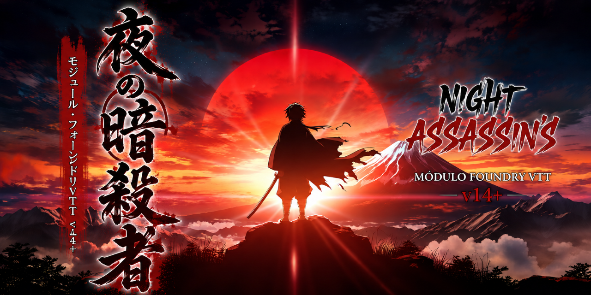

# Night Assassins CSB Automation

[](https://github.com/SoftMissT/night-assassins-csb-automation/releases/latest)
[](https://github.com/SoftMissT/night-assassins-csb-automation/actions/workflows/release.yml)




Módulo de automação para o sistema **Night Assassins** no **Foundry VTT v14**, construído sobre o **Custom System Builder**. Ele distribui os templates oficiais, compêndios e macros usados para atributos, progressão, combate, Respirações, Kekkijutsus e manutenção dos dados do mundo.

Versão declarada no manifesto: **0.11.87**.

## Imagem do módulo

A capa da instalação (tela de Setup do Foundry) e a imagem deste README são o mesmo arquivo:

```text
assets/media/module-cover.webp
```

Para trocar pela arte definitiva, substitua **esse arquivo** mantendo o nome e o caminho — o `module.json` aponta para ele em `media` e o `module.zip` publica a pasta `assets/media/`. Arte atual: WebP 1672×941 (16:9), 367 KB. O card do Setup usa `object-fit: cover`; conforme a largura da janela ele recorta as laterais ou o topo/base, então mantenha o assunto principal centralizado e evite texto grande nas bordas. Nenhum outro arquivo precisa mudar.

## Requisitos

| Dependência              |            Versão |
| ------------------------ | ----------------: |
| Foundry Virtual Tabletop |               v14 |
| Custom System Builder    | 5.2.1 ou superior |
| Dice So Nice!            |       Obrigatório |

## Instalação

### Pelo Foundry (recomendado)

1. Na tela inicial do Foundry, abra **Módulos de Jogo**.
2. Clique em **Instalar Módulo** e cole a URL do manifesto:

```text
https://github.com/SoftMissT/night-assassins-csb-automation/releases/latest/download/module.json
```

3. Instale o módulo.
4. No mundo Night Assassins, abra **Gerenciar Módulos** e ative:
    - Night Assassins CSB Automation;
    - Dice So Nice!.
5. Salve e recarregue o mundo.

### Instalação manual

1. Baixe o `module.zip` da [release mais recente](https://github.com/SoftMissT/night-assassins-csb-automation/releases/latest).
2. Extraia o conteúdo em `{FoundryUserData}/Data/modules/night-assassins-csb-automation/`.
3. Confirme que `module.json` está diretamente nessa pasta.
4. Reinicie o Foundry e ative o módulo no mundo.

## Uso e macros

Ao entrar no mundo como GM, o módulo cria ou atualiza somente o launcher **Night Assassins Controle GM** na pasta **Night Assassins** do Diretório de Macros. As demais macros permanecem no Compendium **Macros Night Assassins**, que preserva os UUIDs usados pelos templates:

- Controle GM;
- Gerenciar Ações, Status, Resistências, Descanso, Vida e Morte e Estados Avançados;
- Teste de Atributo, Rolagem de Acerto e Rolagem de Dano;
- Usar Forma de Respiração, Respiração da Recuperação e Marca do Caçador.

As demais ferramentas do GM (Regeneração Oni, Dupla Alma, Interlúdio, diagnóstico, correções e armas duplicadas) não são macros soltas: ficam no botão **Ferramentas do GM**, dentro do **Controle GM**.

As configurações ficam em **Configurações do Jogo → Night Assassins CSB Automation**.

> A sincronização automática não apaga cópias antigas nem altera hotbars. Ela também não redesenha ou reconecta componentes e botões dos templates CSB existentes no mundo.

## Estado das fichas

| Ficha          | Estado atual                                                                                                                                                                                                                                                       |
| -------------- | ------------------------------------------------------------------------------------------------------------------------------------------------------------------------------------------------------------------------------------------------------------------ |
| **Slayer**     | Abas Combate, Perícias, Habilidades e Config/Dados. Combate na ordem de uso: PDV/PDR, atributos com temporários, botões de combate, Bônus Fixos, Armas, Formas, Status e Vida e Morte. Progressão N1–N20, ações e Respirações. |
| **Oni**        | Combate e Configurações/Dados; Combate na mesma ordem (PDV/PDK, atributos, combate, Bônus Fixos, lista de **Kekkijutsu** com botão Usar, Status). Criação N1, progressão N1–N20, Regeneração, Origens e resistências. A Ferida desconta do PDV. |
| **Oni Minion** | Ficha enxuta com tipos, pacotes de atributos, ataques, traços, fraquezas e PDV/PDK próprios.                                                                                                                                                                       |
| **NPC**        | PDV/PDR no topo, atributos, combate, Bônus Fixos, armas e Personalidade recolhível. Participa do relay genérico e do motor de Acerto/Dano por armas normais. |

### Estado de validação

- Slayer N1–N20: validado no Foundry.
- Vida e Morte do Slayer: validado no Foundry.
- Oni N1–N20: validado no Foundry; ajustes mecânicos adicionais continuam em desenvolvimento.
- Gate de desempenho: aprovado após a remoção das varreduras pesadas do caminho crítico.
- Armas normais Slayer/NPC: contrato e testes automatizados concluídos; validação runtime no Foundry ainda pendente.
- Armas especiais: os dados ficam num catálogo interno do módulo (`catalogs/`), usado pela Dupla Alma; o compêndio de armas guarda só armas normais e os templates de Item. Validação runtime ainda pendente.
- Tela de erro do CSB: o template NPC e o Slayer protegem o filtro de `inventario_categoria`; mundos antigos precisam reimportar o template para receber a fórmula corrigida.
- v0.11.93 (Bônus Fixos, Kekkijutsu no Oni, Ferida no PDV do Oni e fichas reorganizadas): testes automatizados concluídos; validação no Foundry pendente. Reimporte as quatro fichas de ator.

## Respirações publicadas

Somente Respirações com serviço de estado dedicado, testes e auditoria contra a fonte oficial entram no catálogo interno (`catalogs/breathing-items.json`); o hub da ficha importa as Formas dele sob demanda.

| Respiração | Conteúdo publicado               | Estado   |
| ---------- | -------------------------------- | -------- |
| **Chamas** | 9 Estilos + Esquentar            | Auditada |
| **Pedra**  | 5 Estilos                        | Auditada |
| **Névoa**  | 8 Formas + 3 Padrões             | Auditada |
| **Metal**  | 5 Formas + Martelo do Julgamento | Auditada |
| **Neve**   | 7 Formas + Congelar              | Auditada |
| **Vento**  | 9 Estilos + Sangue Especial      | Auditada |

O catálogo de trabalho contém outras Respirações, mas elas não são publicadas até receberem motor, auditoria e testes equivalentes.

## Sistemas e automações

- **Atributos e progressão:** criação e distribuição de atributos, snapshots por nível e progressões específicas de Slayer e Oni.
- **Combate:** Acerto, Bloqueio, Esquiva, Dano, Cura, ações e recursos.
- **Críticos de armas:** o limiar vem do perfil/Item da arma; não é fixado globalmente em 20.
- **Dano entre atores:** relay genérico para Slayer, Oni, Oni Minion e NPC, com aprovação do GM quando aplicável.
- **Dice So Nice!:** rolagens mecânicas devem aguardar e exibir os dados 3D antes da mensagem final de resultado.
- **Bônus derivados:** resolvedor central para atributos, Metal/Cor, Respiração, Status e Habilidades Especiais.
- **Bônus Fixos da ficha:** Slayer, Oni, Oni Minion e NPC têm campos de Acerto (todo Acerto), Dano (toda rolagem de dano) e Defesa/Testes (Bloqueio, Esquiva e testes de atributo), mostrados como "Bônus da ficha". Fichas antigas precisam reimportar o template para ganhar os campos.
- **Oni:** progressão, Regeneração, Origens, Kekkijutsus, Classes, Especializações e painel do GM.
- **Diagnóstico:** Journal exclusivo do GM, filtrado para eventos atribuídos ao módulo.

## Compêndios

| Compêndio                                | Conteúdo                                             |
| ---------------------------------------- | ---------------------------------------------------- |
| **Macros Night Assassins**               | Macros chamadas pelos templates (por UUID)           |
| **Night Assassins Templates de Ficha**   | Slayer, Oni, Oni Minion e NPC                        |
| **Night Assassin's Respirações**         | Template de Respiração; as Formas são importadas do catálogo pelo hub da ficha |
| **Night Assassin's Armas dos Caçadores** | Armas normais e templates de Item (arma, especial, Forma, Kekkijutsu) |
| **Night Assassin's Arte**                | Assets e ícones distribuídos pelo módulo             |

Os geradores consomem as fontes versionadas do projeto. Arquivos gerados em `build/` não são fonte de verdade e não devem ser editados manualmente. O `release.yml` reempacota os compêndios a partir de `src/` e `macros/` antes de publicar.

## Reparo de dados legados

Mundos antigos podem conter Items cujos IDs de template foram remapeados pelo CSB ou cujas propriedades mecânicas foram apagadas durante um reload.

Todas ficam em **Controle GM → Ferramentas do GM → Manutenção do mundo**:

- **Corrigir armas:** reconhece armas pelos dados reais do Item e reidrata categoria, crítico, perfis e propriedades mecânicas a partir do catálogo canônico.
- **Corrigir Respirações:** sincroniza Items de Respiração com o catálogo interno, preservando IDs remapeados pelo CSB.
- **Diagnóstico de erros:** cria, abre e exporta o Journal operacional do módulo para o GM.
- **Armas duplicadas:** lista armas repetidas do personagem selecionado e exclui só o Item que você confirmar.

Os reparos são idempotentes: executar novamente sobre um documento já corrigido não deve gerar alterações adicionais.

## Troubleshooting

| Sintoma                               | Ação recomendada                                                                                                                 |
| ------------------------------------- | -------------------------------------------------------------------------------------------------------------------------------- |
| Arma não aparece ou não possui perfil | Execute **Corrigir armas** (Controle GM → Ferramentas do GM), feche e reabra a ficha. Use um Item novo do compêndio para comparar. |
| Respiração ou Forma perdeu dados      | Execute **Corrigir Respirações** (Ferramentas do GM) e reabra a ficha.                                                           |
| Journal não abre ou não exporta       | Confirme que está conectado como GM e use **Diagnóstico de erros** em Ferramentas do GM.                                         |
| Fórmula CSB mostra `ERROR`            | Reimporte o template oficial do compêndio; Actors antigos podem manter fórmulas de versões anteriores.                           |
| Erros `compareText`/`equalText` no console | Reimporte o template do compêndio (NPC ou Slayer). A fórmula antiga fica salva no mundo até o template ser recarregado.      |
| Asset retorna 404                     | Confirme que `module.zip` contém `assets/icons/`, `assets/fonts/` e `assets/media/`, e que a instalação não criou pasta duplicada. |
| Mundo fica lento após ativar o módulo | Desative temporariamente a automação afetada, exporte o Journal de diagnóstico e informe versão do Foundry, CSB e módulo.        |

## Desenvolvimento

O fluxo de contribuição, geração dos compêndios e validação de release será documentado separadamente. Para executar a suíte atual:

```powershell
node --version
node --test
git diff --check
```

Não edite manualmente conteúdo gerado em `build/` ou nos diretórios de packs. A capa do módulo é a exceção de asset: troque somente `assets/media/module-cover.webp`.

## Licença

MIT.
